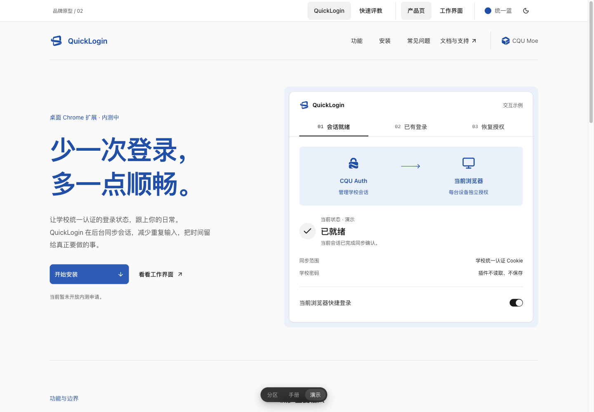

# 统一蓝色 · design 1.2.0

范围：共享 theme / ui、七个产品品牌素材、同步工具、正式预览与文档。展示页第三版按用户提供的 Diolen 参照重排，作为可交互候选保留，不强制消费产品复制版式。真实消费者、registry、部署均未改动。

## 色值变更

`packages/theme/src/tokens.css` 是唯一品牌色源。颜色集中为 H=258，通过明度与色度适配不同用途；工作界面 primary、状态色、导航和开关未变。

| 声明             | 旧值                 | 新值 / 目的                                  |
| ---------------- | -------------------- | -------------------------------------------- |
| 浅色 brand-solid | 无                   | `oklch(.49 .16 258)`：展示页实底             |
| brand-on-solid   | 无                   | `oklch(.99 0 0)`：实底上的文字，深色继承     |
| 浅色 brand-ink   | 无                   | `oklch(.45 .16 258)`：Logo、标题、链接、焦点 |
| 浅色 brand-soft  | 无                   | `oklch(.955 .018 258)`：展示衬底             |
| 深色 brand-solid | 无                   | `oklch(.39 .1152 258)`：降低饱和度的实底     |
| 深色 brand-ink   | 无                   | `oklch(.8 .088 258)`：提高明度，适应深底     |
| 深色 brand-soft  | 无                   | `oklch(.29 .025 258)`：深色展示衬底          |
| 浅色 ring        | `oklch(.5 0 0)`      | `var(--brand-ink)`：统一蓝色焦点             |
| 浅色 link        | `oklch(.46 .16 255)` | `var(--brand-ink)`：消除独立色相             |
| 深色 ring        | `oklch(.7 0 0)`      | 删除覆写，继承品牌别名                       |
| 深色 link        | `oklch(.78 .1 255)`  | 删除覆写，继承品牌别名                       |

深色声明在显式 `data-theme='dark'` 和无显式主题的系统深色分支各一份，同值。`packages/ui/src/styles.css` 新增对应四个 `--color-brand-*` 映射，无独立色值。原型移除重复颜色定义，直接消费主题产物；局部 `--primary` 只映射展示页 CTA。

素材旧配色来自历史 palette；快速评教来自已批准主仓库 `c2bccbb`，原轮廓全部保留：

| 产品       | 原浅底 / 深底         | 统一浅底 / 深底       |
| ---------- | --------------------- | --------------------- |
| schedule   | `#1c50aa` / `#99bfff` | `#0850ab` / `#9bc0f7` |
| auth       | `#089891` / `#89ccc7` | `#0850ab` / `#9bc0f7` |
| quicklogin | `#eb6433` / `#f6a88d` | `#0850ab` / `#9bc0f7` |
| feed       | `#b13758` / `#f6a3b1` | `#0850ab` / `#9bc0f7` |
| learning   | `#327354` / `#a0c9b2` | `#0850ab` / `#9bc0f7` |
| cqu-moe    | `#6951a5` / `#c1b4ef` | `#0850ab` / `#9bc0f7` |
| jxzljc     | `#a66b18` / `#deb588` | `#0850ab` / `#9bc0f7` |

所有应用 / 扩展图标蓝底使用浅色 brand-solid（`#195cb9`），白色图形保持不变。素材生成器不再读产品专属色，`marks.json` 只负责批准的几何与元信息。网页入口、favicon、SVG/PNG/ICO 和同步脚本同时更新。

## 接入

1. 同时升级 theme / ui 到 1.2.0，模板依赖已经同步；根锁文件经离线 frozen 安装验证，无新增依赖。
2. 通过 `pnpm brand:sync <product> <repo-root>` 同步资源，再运行 `brand:check`；支持七个产品及 QuickLogin 扩展目录。
3. 页面 Logo 按实际主题选择蓝色浅深文件；favicon 自适应系统主题。单色文件留作印刷、兼容和轮廓验证。
4. 工作界面不覆盖 primary。展示页品牌 CTA 用现有 Button，并局部映射 `--primary: var(--brand-solid)` 和 `--primary-foreground: var(--brand-on-solid)`，不新增 variant。

## 验证记录

- `pnpm check`：构建、类型检查、5 项单元测试、27 项规则/分发测试、设计规则通过。
- `pnpm test:e2e`：108 项桌面/移动测试通过，运行记录 `artifacts/e2e/preview-PrR3Z7/run.json`。新增主题测试检查蓝色展示按钮、中性工作按钮、显式与系统主题分支及文字对比度。
- `pnpm verify:consumer`：真实打包并安装 1.2.0、迁移目录、构建、规则与双主题交互通过，运行记录 `artifacts/e2e/consumer-y5gDqr/run.json`。主线合入后重新执行三项必需检查，全部通过。
- 素材目录 8 组宽度/主题、70 个实际图像颜色样本、21 次下载通过；7 组 ICO 的内嵌图片与 PNG 一致，零控制台错误、零外部请求。
- 独立原型 2 产品 × 3 版式 × 4 宽度 × 2 主题共 48 组：无横向溢出、标识加载正常、输入至少 16px、操作命中区至少 44px。正式 `/brand` 另检查 8 组，包含全部 7 产品。
- 快速评教演示检查填写、核对、完成状态、重新查看及值保留；QuickLogin 检查已有登录、恢复授权、暂停与工作界面。全部使用本地合成数据。
- 实看新版首屏双主题、移动快速评教、正式品牌目录双主题和七产品总览。按 touch-and-accessibility / ui-review 检查，修正小屏入口隐藏、下拉框和品牌示例按钮命中区；未发现剩余阻塞交互问题。
- `docs/contrast.json`：文字与背景最小比值 6.25:1；品牌文字在浅/深衬底分别为 6.72 / 7.56，品牌按钮为 6.25 / 9.48，工作按钮为 16.79 / 13.61，均超过 AA 正文要求。
- 文档独立试写发现猜测业务默认值、开发提示进入界面和误用外部 currentColor SVG，补充了正反例；试写未构建，不能替代真实页面验收。

构建仍有既有大于 500kB chunk 提示；本次无新增依赖。浏览器自动化曾因模拟视口高于原生窗口导致点击定位失败，改为 760px 高并显式滚动后完成，不是产品提交失败。

本地尚未验证真实手机、Safari、Firefox、已安装扩展或真实账号；tag 工作流另执行 Firefox / WebKit 门禁，实际结果以对应 Actions run 为准。消费者迁移与部署在各产品升级 issue 中执行；展示版式与小尺寸同色辨识度仍需用户实际使用反馈。

## 发布顺序

用户已授权：design PR → CI 通过后合并 → v1.2.0 tag 的完整门禁与 GitHub Release → 各产品「升级前端版本」issue。发行包由现有工作流发布通过验证的原始 tarball，并附 SHA256SUMS；不发布到 npm。合并、发行与消费者上线分别记录。

此截图为本地可交互原型；正式品牌目录为 `/brand`，原型仅在开发服务器提供。
