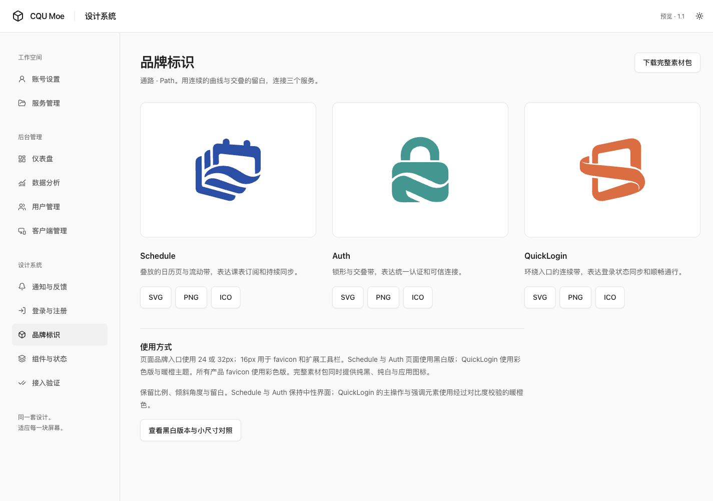
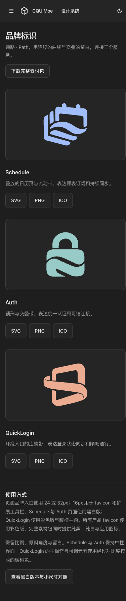

# Logo 接入验收 · 2026-10-13

## 最终规则

| 产品 | 页面与弹窗 | favicon / 应用图标 |
| --- | --- | --- |
| Schedule | 浅色纯黑、深色纯白，32px | 彩色 |
| Auth | 浅色纯黑、深色纯白，32px | 彩色 |
| QuickLogin | 彩色透明标识，暖橙主题 | 彩色；扩展工具栏使用圆角应用图标 |

三套素材以 `assets/brand/path-family/source/marks.json` 为主源。复制内容通过 `brand:check` 核对 SHA-256：Schedule 8 项、Auth 8 项、QuickLogin 12 项，覆盖网页、扩展弹窗和工具栏。

## design

- 新增 `/brand` 正式预览和下载入口；独立目录保留黑白版及 16 / 24 / 32 / 48px 对照。
- `brand:build` 重建矢量/位图与 ZIP；`brand:prepare` 仅准备忽略跟踪的预览资产；`brand:sync` 显式指定业务仓库；`brand:check` 只读校验复制结果。
- `pnpm check` 通过（5 项单元测试、7 项规则/分发测试），`pnpm test:e2e` 69 项通过，`pnpm verify:consumer` 独立安装、构建及浏览器验证通过。
- 新页在 320、390、768、1440 × 浅/深色下图片加载正常，无横向溢出；11 个素材/目录链接 HTTP 检查通过；下载链接可用 Tab 到达且焦点可见。
- 素材目录单独验证 8 个主题/宽度组合与 9 个实际下载，详见素材包 `VERIFICATION.md`。
- theme / ui 保持 1.1.0；本次不改变组件 API 和共享主题行为。构建仍有既有的大 chunk 提示。

## 产品

- Schedule：前端构建、设计规则、22 文件 / 182 测试通过。四种宽度与双主题验证；手动偏好与系统主题相反时，每个入口只显示正确的一张 Logo。
- Auth：前端构建、lint、设计规则通过；根测试 98 文件 / 901 测试通过。登录入口在四种宽度与双主题验证黑白选择、单张显示且无溢出；三个入口复用同一 BrandLogo。
- QuickLogin：版本同步为 0.4.4，更新发布说明。扩展类型检查、21 文件 / 124 测试、构建、包契约检查、10 项发布工具测试，以及官网类型检查、构建、6 页链接资源检查通过。
- QuickLogin 官网四种宽度 × 双主题无溢出，透明彩色 Logo 随系统主题切换；官网弹窗示例同步真实弹窗样式。主操作文字对比度约 5.93:1（浅）/ 8.62:1（深），状态强调对背景约 3.28:1 / 9.21:1，次要文字约 4.69:1 / 7.25:1。

源码提交：Schedule `39c50d6`、Auth `acbd6f8`、QuickLogin `ca2ca90`（仅实现提交；后续候选记录为文档提交）。规范轴复核无发现；需求轴曾指出缺少本记录，现已补齐。

外观记录：[Auth 深色手机布局](screenshots/brand-auth-mobile-dark.png)、[QuickLogin 浅色弹窗](screenshots/brand-quicklogin-popup-light.png)、[QuickLogin 深色弹窗](screenshots/brand-quicklogin-popup-dark.png)、[Schedule 手机布局](screenshots/brand-schedule-mobile-light.png)。弹窗为合成状态。

## 边界与发布

全部修改在隔离 worktree，保留用户原工作区。此记录是本地实现与验收证据，不是生产部署证据。

- Auth / Schedule 本地预览未启动业务后端，出现预期的会话接口失败；未访问真实账号、课程或考试数据。Auth 管理台与登录后入口通过共享组件和编译检查，未使用真实管理员会话验收。
- QuickLogin 弹窗使用构建产物及合成 chrome.runtime 状态检查视觉；没有加载真实扩展后台、写 Cookie 或访问学校 SSO。官网检查阻断 Auth 生产 API，因此下载区展示暂不可用状态；不把这一模拟状态作为线上故障。
- QuickLogin 的发布 commit、ZIP 与 SHA-256 记录在其 `docs/operations/quicklogin-release.md`；本地候选包与官网 canary、商店发布分别记录。
- 尚未验证真实手机、Safari、Firefox、已安装扩展升级或真实账号业务。未执行 Cloudflare 部署或 Chrome Web Store 上传。
